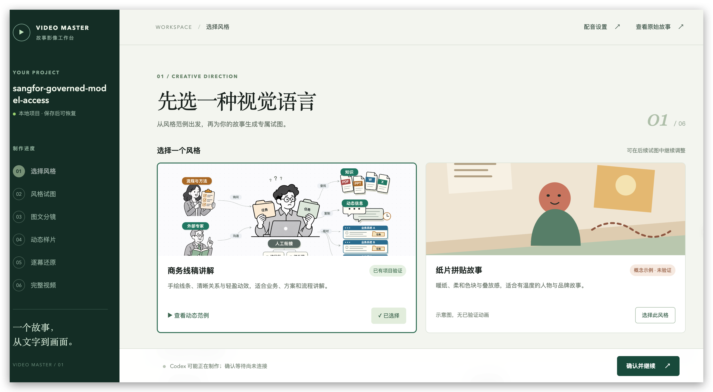

# Video Master

把已经准备好的故事或旁白制作成视频，通过本地审阅页面逐阶段确认视觉风格、分镜、动态样片、逐幕视频和最终成片。Skill 定义的是 AI 助手的制作与协作流程；审阅页面负责展示和记录意见，视频、图片和配音仍由助手调用合适的工具制作。

## 使用前提

1. **先准备内容。** 需要一份从头到尾完整、连贯的故事、讲解稿或旁白稿，作为事实和叙事依据。如果手里只有主题、零散资料或想法，可以先让助手整理成故事或旁白稿，确认内容后再进入本 Skill 的视频制作流程。助手应保留原始内容，不擅自编造事实；必要的改写要明确提出。
2. **先安装 Remotion Skill。** 本流程使用 Remotion 制作视频，需要在所用 AI 编程助手中安装 [Remotion 官方 Agent Skills](https://github.com/remotion-dev/skills)，至少选择 `remotion-best-practices`。在终端运行：

   ```bash
   npx skills add remotion-dev/skills
   ```

   按提示选择使用的助手和 Skill。Remotion Skill 是给助手阅读的制作规范，不等同于项目的 Remotion 代码依赖；实际视频项目仍需要安装相应的 npm 依赖。
3. **准备配音方式。** 默认推荐使用小米 MiMo，也可以明确选择其他配音服务。使用 MiMo 时：

   1. 登录 [小米 MiMo 开放平台](https://platform.xiaomimimo.com/)，在控制台的 API Keys 中创建自己的 Key，并确认服务权限和额度。
   2. 启动 Video Master 审阅页面后，点击右上角「配音设置」，将 Key 粘贴进去并保存。macOS 使用系统钥匙串，Windows 使用系统凭据管理器；其他系统可通过启动进程的 `MIMO_API_KEY` 环境变量配置。
   3. 告诉助手使用 MiMo 配音及希望的音色；内置配音脚本使用 `mimo-v2.5-tts` 模型，实际调用以服务权限和可用情况为准。保存成功只表示凭据已配置，实际合成时才会验证服务连接和权限。

   如果没有配置或服务不可用，先配置好，或明确告诉助手改用其他服务；助手不应悄悄替换声音。请勿把 Key 发到聊天里或提交到仓库。

## 安装 Video Master

把下面的地址发给你的 Agent，请它安装 Video Master Skill：

```text
请安装这个 Skill：https://github.com/alannewlife/skills/tree/main/video-master
```

Agent 会按所用工具的方式安装完整 Skill；如果本机已有同名版本，请让它先检查并保留已有修改。安装后可在新会话中使用 `video-master`，或直接告诉助手要用 Video Master 把准备好的故事制作成视频。

## 怎么使用

先把故事或旁白保存为 UTF-8 文本或 Markdown 文件，然后向助手说明，例如：

```text
请用 video-master 把 /path/to/story.md 制作成视频。
先按照审阅流程展示风格、分镜和样片，再逐幕确认视频片段，最后合成成片。
```

助手调用 Skill 后，会初始化项目、启动本机审阅页面并提供实际地址。打开地址后，就可以看到类似下面的界面：



流程依次是：

1. 选择视觉风格，设置项目品牌素材。
2. 根据故事生成一张代表性的风格画面并确认。
3. 审阅每幕分镜、旁白和元素拆分计划。
4. 审阅带旁白的动态样片，确认实际元素运动与画面还原。
5. 逐幕播放并审阅视频片段：检查旁白、重点放大、元素和连线出现时机，以及回到全景的效果。
6. 合成已确认的片段，审阅最终视频；确认完成后可在页面播放、下载及复制本机文件路径。

每一阶段都由用户确认后再进入下一阶段。修改意见交由助手处理，处理完成后重新审阅；直接保存意见不等于完成修改。审阅页面本身不会唤醒已经结束的助手对话，如果对话停止，请在聊天中让助手继续。

## 目录与素材说明

- `SKILL.md`：助手执行流程的入口。
- `scripts/`、`ui/`：项目状态、本地审阅服务、页面和配音辅助脚本。
- `references/`：制作约定和项目、审阅协议。
- `styles/`、`assets/`：风格参考和 Remotion 示例模板。
- `docs/`：使用说明中的界面截图。

内置模板与风格参考含示例品牌标识和示例音频，仅用于展示和启动流程。项目可在风格页面替换或移除默认 Logo；正式制作时应根据项目替换或移除示例素材。用户的视频项目、原始资料、成片和凭据不包含在此 Skill 中。

如需手动启动或恢复本地审阅服务，参见 [项目与确认协议](references/protocol.md)；实际的动画制作和逐幕还原要求参见 [制作说明](references/production.md)。
